

# Dossier technique

### Plateforme, politique de filtrage et preuves des 25 tests

[← Accueil](README.md)

Ce dossier rassemble les éléments techniques de MediConnect : la plateforme de validation, la politique de filtrage, puis **les vingt-cinq tests avec leurs captures d’écran réelles** (T01 à T25) et la matrice d’accès. Chaque capture est un écran de la console des machines virtuelles, simplement recadré ; aucun mot de passe ni code TOTP n’y apparaît.

## Sommaire

1. [Plateforme de validation](#1-plateforme-de-validation)
2. [Architecture et plan d’adressage](#2-architecture-et-plan-dadressage)
3. [Politique de filtrage](#3-politique-de-filtrage)
4. [Résultats des 25 tests](#4-résultats-des-25-tests)
5. [Preuves : portails exposés à Internet (T01 à T06)](#5-preuves--portails-exposés-à-internet-t01-à-t06)
6. [Preuves : VPN SSL et droits par groupe (T07 à T12, T14)](#6-preuves--vpn-ssl-et-droits-par-groupe-t07-à-t12-t14)
7. [Preuves : séparation production et démonstration (T13)](#7-preuves--séparation-production-et-démonstration-t13)
8. [Preuves : portail captif et matrice d’accès (T15)](#8-preuves--portail-captif-et-matrice-daccès-t15)
9. [Preuves : administration (T16, T17)](#9-preuves--administration-t16-t17)
10. [Preuves : site 2 et tunnel IPsec (T18 à T21)](#10-preuves--site-2-et-tunnel-ipsec-t18-à-t21)
11. [Preuves : DMZ, WAF et anti-usurpation (T22, T23, T25)](#11-preuves--dmz-waf-et-anti-usurpation-t22-t23-t25)
12. [Preuves : journalisation (T24)](#12-preuves--journalisation-t24)
13. [Pour aller plus loin](#13-pour-aller-plus-loin)

## 1. Plateforme de validation

| Élément | Détail |
| --- | --- |
| Pare-feux | Deux appliances virtuelles Stormshield EVA, SNS 4.8.14 : **FW-HQ** (siège) et **FW-BR** (site 2) |
| Machines | Sept machines Debian 12 sous VirtualBox : `vm-lan`, `vm-srv`, `vm-dmz`, `vm-demo`, `vm-admin`, `vm-internet`, `vm-br` |
| Internet simulé | Plage de documentation 203.0.113.0/24 (RFC 5737) ; client de test en 203.0.113.50 |
| Identités | Annuaire LDAP interne du pare-feu (domaine `mediconnect.lan`) ; un compte de test par groupe, par exemple `u_support`, `u_compta`, `u_employe`, `u_it`, `u_admin`, `u_commercial` |
| Portails | Deux petits serveurs web nginx simulent le portail public et le portail professionnel (mot de passe et code TOTP) |
| Heures | Les heures citées sont celles de la console de la machine concernée |

**Méthode des preuves.** Les commandes sont saisies dans la console des machines virtuelles et les captures sont les écrans correspondants. Les connexions aux portails captifs (T15, T18) sont faites par un navigateur piloté par script, hors de la zone filmée : Chromium dans `vm-lan` pour T15, Edge sans fenêtre sur l’ordinateur hôte pour T18, relié à FW-BR par un tunnel SSH via `vm-br`. Elles sont prouvées par la ligne `AUTH` du journal du pare-feu. Pour T04, T05, T07, T12 et T14, le mot de passe et le code TOTP sont déposés par script dans des fichiers privés juste avant la commande affichée, afin qu’aucun secret n’apparaisse à l’écran.

## 2. Architecture et plan d’adressage

  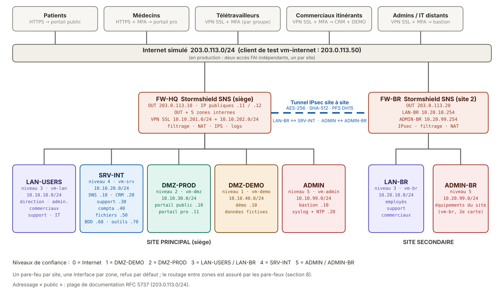

Six niveaux de confiance, de 0 (Internet) à 5 (administration) :

| Niveau | Zone | Réseau | Contenu |
| --- | --- | --- | --- |
| 0 | Internet | 203.0.113.0/24 | Patients, médecins, nomades, site 2 avant tunnel |
| 1 | DMZ-DEMO | 10.10.40.0/24 | Copie simplifiée du portail, données fictives |
| 2 | DMZ-PROD | 10.10.30.0/24 | Portail public (.10) et portail professionnel (.11) |
| 3 | LAN-USERS, LAN-BR | 10.10.10.0/24, 10.20.10.0/24 | Postes des employés, du support, des commerciaux |
| 4 | SRV-INT | 10.10.20.0/24 | DNS .10, CRM .20, support .30, compta .40, fichiers .50, BDD .60, outils techniques .70 |
| 5 | ADMIN, ADMIN-BR | 10.10.99.0/24, 10.20.99.0/24 | Bastion .10, syslog et NTP .20, poste d’administration .100 |

Côté Internet : FW-HQ en 203.0.113.10, portail public en 203.0.113.11 (traduit en 10.10.30.10), portail professionnel en 203.0.113.12 (traduit en 10.10.30.11), FW-BR en 203.0.113.20. Les pools du VPN SSL sont 10.10.201.0/24 (UDP) et 10.10.202.0/24 (TCP).

## 3. Politique de filtrage

La politique compte **26 règles sur FW-HQ et 16 sur FW-BR**, soit 42 règles, avec **refus par défaut** : la règle finale **R22** bloque et journalise tout flux non prévu. Les règles qui reviennent dans les preuves :

| Règle | Rôle | Vu dans |
| --- | --- | --- |
| R1, R2, R3 | Administration : interface du pare-feu depuis la zone ADMIN, bastion vers les serveurs, administration entre les sites | T10, T17, T18 |
| R4 | Envoi des journaux vers le collecteur syslog | T24 |
| R5, R5a | DNS et portail captif pour les postes non authentifiés | T15, T16, T18 |
| R6, R7, R8, R9 | Droits par groupe : support, comptabilité, employés, informatique | T07 à T10, T15, T18 |
| R14 | Tunnel IPsec : site 2 vers SRV-INT | T18 |
| R15 | Sortie Internet des employés authentifiés | T15 |
| R18, R19 | Portail public et portail professionnel, TCP 443 | T01, T03, T23 |
| R20 | DMZ-PROD vers la base de données, TCP 3306 | T22 |
| **R22** | **Blocage et journalisation de tout le reste** | T02, T06, T12, T13, T16, T22 |

## 4. Résultats des 25 tests

**25 tests sur 25 conformes**, plus une matrice d’accès pour quatre comptes. Les chiffres en gras sont ceux repris dans la vidéo de présentation.

| N° | Scénario | Résultat observé | Verdict | Figure |
| --- | --- | --- | --- | --- |
| T01 | Patient : HTTPS vers 203.0.113.11 depuis Internet | Page « PORTAIL PUBLIC » (serveur 10.10.30.10) | Conforme | [34a](#figure-34) |
| T02 | Patient : HTTP (port 80) vers 203.0.113.11 | Délai dépassé après 5 s | Conforme | [35a](#figure-35) |
| T03 | Balayage des ports 22, 80, 443, 1194, 3306, 8080 sur .11 et .12 | Seul 443 ouvert ; cinq ports filtrés sur chaque adresse | Conforme | [35b, d](#figure-35) |
| T04 | Médecin : mot de passe et code TOTP | « Connecté : dr.martin (mot de passe + code TOTP vérifiés) » | Conforme | [34b](#figure-34) |
| T05 | Médecin : code TOTP incorrect | « Accès refusé : code TOTP incorrect » | Conforme | [34c](#figure-34) |
| T06 | Internet : route forcée vers 10.10.20.0/24 | Ping à 100 % de perte, curl en délai dépassé | Conforme | [35c](#figure-35) |
| T07 | VPN SSL `u_support` (UDP) : support, puis comptabilité | .30 : page SUPPORT ; .40 : délai dépassé | Conforme | [36](#figure-36), [37](#figure-37) |
| T08 | VPN SSL `u_compta` (UDP) : comptabilité, puis support | .40 : page COMPTA ; .30 : délai dépassé | Conforme | [36](#figure-36), [37](#figure-37) |
| T09 | VPN SSL `u_it` (TCP) : SSH vers .70, puis HTTPS vers .40 | SSH atteint (clé exigée) ; .40 : délai dépassé | Conforme | [38](#figure-38) |
| T10 | VPN SSL `u_admin` : SSH vers le bastion, puis HTTPS vers le pare-feu | Bastion atteint (clé exigée) ; pare-feu : délai dépassé | Conforme | [38](#figure-38), [40](#figure-40) |
| T11 | VPN SSL `u_commercial` : CRM, démonstration, comptabilité | CRM et DEMO : pages ; comptabilité : délai dépassé | Conforme | [39](#figure-39), [37](#figure-37) |
| T12 | VPN SSL `u_commercial` vers le portail de production 10.10.30.10 | Délai dépassé ; trois blocages R22 | Conforme | [39d](#figure-39), [40a](#figure-40) |
| T13 | Depuis DMZ-DEMO : ping vers SRV-INT et Internet, DNS | 100 % de perte ; DNS sans réponse | Conforme | [42](#figure-42) |
| T14 | VPN SSL : mot de passe sans code, code faux, code rejoué, mauvais mot de passe | **Quatre `AUTH_FAILED`**, pas d’interface `tun0` ; journal : « bad password », « invalid TOTP code » | Conforme | [41](#figure-41) |
| T15 | Poste LAN non authentifié, puis employé authentifié | Redirection vers le portail, DNS seul ; puis Internet oui, support non | Conforme | [43](#figure-43), [44](#figure-44), [45](#figure-45) |
| T16 | Poste LAN : interface web et SSH du pare-feu, même avec `u_admin` | 302 puis 403 ; SSH en délai dépassé | Conforme | [48](#figure-48) |
| T17 | Poste ADMIN : interface web ; bastion vers serveurs ; poste 10.10.99.100 vers SRV-INT | Interface ouverte ; SSH par clé réussi ; poste .100 refusé | Conforme | [49a à d](#figure-49), [45](#figure-45) |
| T18 | Site 2 : portail FW-BR, accès par groupe à SRV-INT, administration de FW-BR | Redirection ; .30 oui, .40 non ; FW-BR : 200 et SSH | Conforme | [50](#figure-50), [49e](#figure-49), [51](#figure-51) |
| T19 | Site 2 vers LAN-USERS et DMZ-PROD | 100 % de perte ; délais dépassés | Conforme | [52a](#figure-52) |
| T20 | Site 2 vers Internet | 200 ; source vue 203.0.113.20 | Conforme | [52b, c](#figure-52) |
| T21 | Coupure puis rétablissement du tunnel | **Détection en 67 s** (journal), 78 s (supervision) ; **reprise en environ 4 s** | Conforme | [53](#figure-53), [54](#figure-54) |
| T22 | Depuis DMZ-PROD : Internet, LAN, base de données, autre serveur | Internet et LAN refusés ; 3306 ouvert ; .30:443 refusé | Conforme | [55](#figure-55) |
| T23 | Traversée de répertoire vers le portail public | Avant WAF : HTTPS 400 du serveur sans alarme ; en clair sur 443 : bloquée, alarme 117. Avec WAF (T23c) : chemin exact **400** (nginx), traversée en paramètre **403** (WAF) ; R18 sans alarme | Conforme | [56](#figure-56), [56 suite](#figure-56-suite) |
| T24 | Réception des journaux de FW-HQ et FW-BR sur le syslog | `fw-hq.log` et `fw-br.log` alimentés ; R22 et R4 visibles | Conforme | [58](#figure-58), [40](#figure-40) |
| T25 | Usurpation d’une adresse interne depuis Internet | Sans réponse ; alarmes « Usurpation d’adresse IP (type=2) » bloquées | Conforme | [57](#figure-57) |
| Mat. | Matrice d’accès : quatre comptes, six cibles | Chaque compte n’atteint que la ressource de son groupe | Conforme | [46](#figure-46), [47](#figure-47) |

## 5. Preuves : portails exposés à Internet (T01 à T06)

Depuis `vm-internet`, les deux portails répondent en HTTPS sur leur adresse publique ; le port 80, les ports de gestion et la base de données sont filtrés, et aucune route forcée ne permet d’atteindre SRV-INT. Le portail professionnel refuse un code TOTP incorrect.

  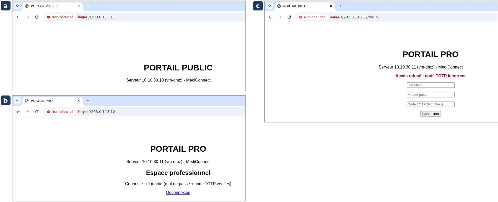

**Figure 34 · Portails publiés vus depuis Internet (T01, T04, T05).** (a) T01 : `https://203.0.113.11` depuis `vm-internet`, page « PORTAIL PUBLIC », serveur 10.10.30.10 (certificat auto-signé, d’où la mention « Non sécurisé »). (b) T04 : `https://203.0.113.12`, espace professionnel, « Connecté : dr.martin (mot de passe + code TOTP vérifiés) ». (c) T05 : `https://203.0.113.12/login`, « Accès refusé : code TOTP incorrect ».

  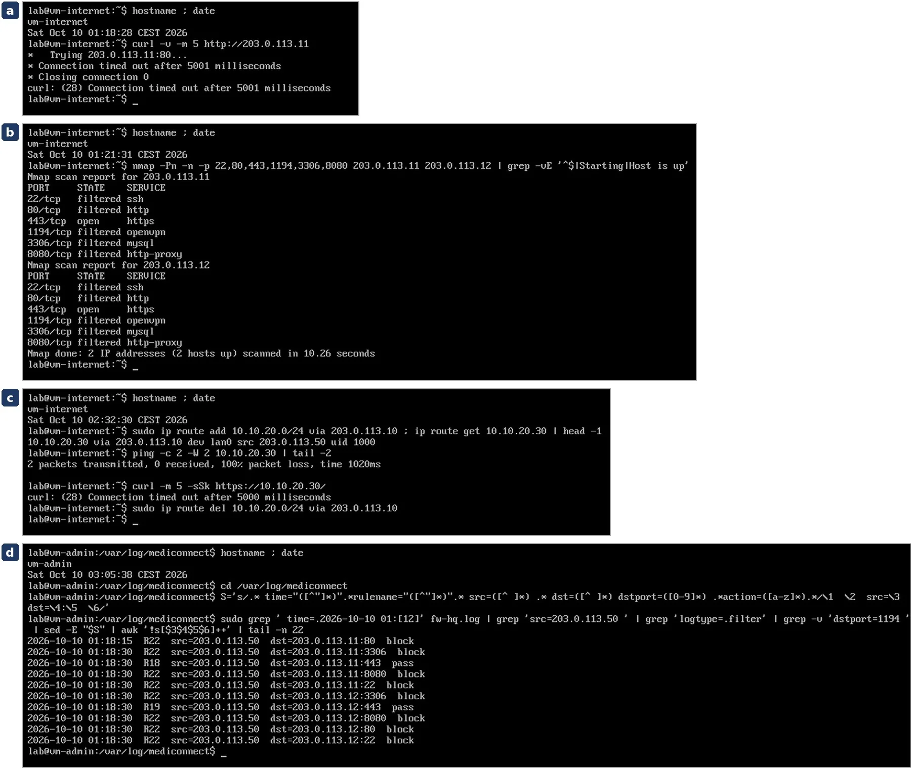

**Figure 35 · Accès directs et balayage de ports depuis Internet (T02, T03, T06).** (a) T02 (01:18:28) : `curl http://203.0.113.11`, délai dépassé après 5 s, le port 80 n’est pas publié. (b) T03 (01:21:31) : `nmap` des ports 22, 80, 443, 1194, 3306 et 8080 sur les deux adresses publiques, seul 443 est ouvert, les cinq autres sont filtrés. (c) T06 (02:32:30) : route ajoutée vers 10.10.20.0/24 par 203.0.113.10, ping avec 100 % de perte, `curl` vers 10.10.20.30 en délai dépassé, route retirée. (d) Journal de FW-HQ (source 203.0.113.50) : R22 bloque les ports 80, 3306, 8080 et 22 ; R18 (portail public) et R19 (portail professionnel) laissent passer 443.

## 6. Preuves : VPN SSL et droits par groupe (T07 à T12, T14)

Chaque compte atteint uniquement la ressource de son groupe, en UDP comme en TCP ; les autres destinations restent en délai dépassé et le journal du pare-feu enregistre un blocage R22. Les quatre tentatives d’authentification fautives sont refusées sans que l’interface `tun0` soit créée.

  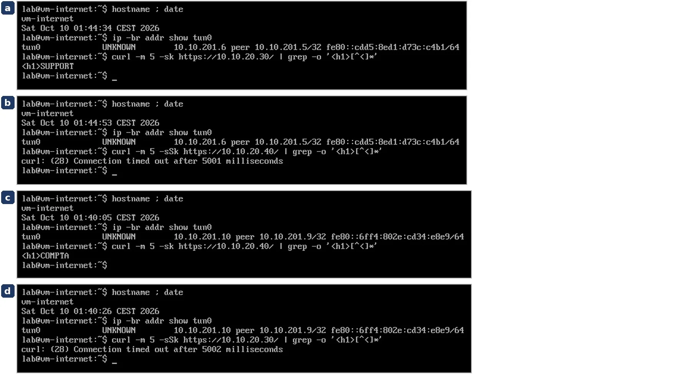

**Figure 36 · Comptes support et comptabilité, flux autorisé et flux refusé (T07, T08).** (a) T07 (01:44:34) : `u_support`, tunnel UDP (`tun0` 10.10.201.6), `https://10.10.20.30/` renvoie la page SUPPORT. (b) T07 (01:44:53) : même session, `https://10.10.20.40/` (comptabilité), délai dépassé. (c) T08 (01:40:05) : `u_compta`, tunnel UDP (`tun0` 10.10.201.10), `https://10.10.20.40/` renvoie la page COMPTA. (d) T08 (01:40:26) : même session, `https://10.10.20.30/` (support), délai dépassé.

  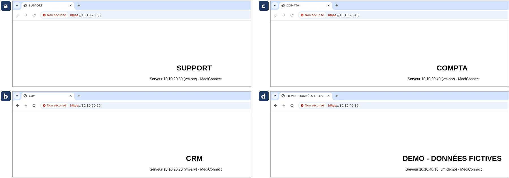

**Figure 37 · Pages obtenues dans le navigateur de `vm-internet` (T07, T08, T11).** (a) T07 : `https://10.10.20.30`, SUPPORT (`u_support`). (b) T11 : `https://10.10.20.20`, CRM (`u_commercial`). (c) T08 : `https://10.10.20.40`, COMPTA (`u_compta`). (d) T11 : `https://10.10.40.10`, « DEMO - DONNÉES FICTIVES » (`u_commercial`).

  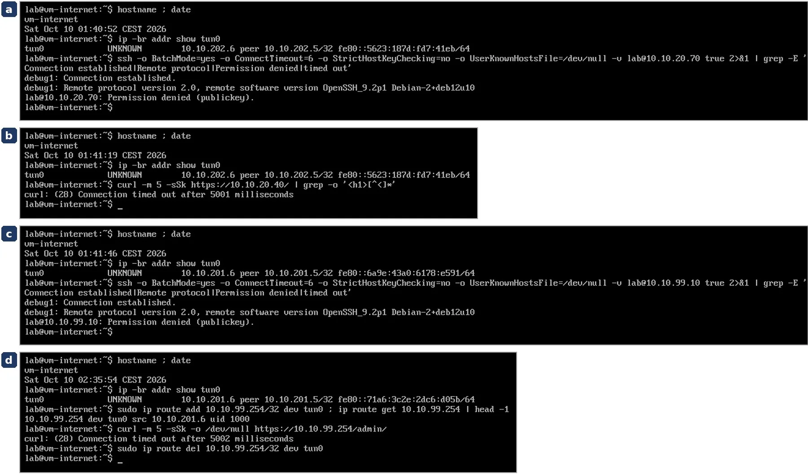

**Figure 38 · Compte informatique en TCP et compte administrateur (T09, T10).** (a) T09 (01:40:52) : `u_it`, tunnel TCP (`tun0` 10.10.202.6), `ssh` vers 10.10.20.70 atteint le serveur (OpenSSH 9.2p1) ; sans clé, « Permission denied (publickey) », aucune session ouverte. (b) T09 (01:41:19) : même session, `https://10.10.20.40/` (comptabilité), délai dépassé. (c) T10 (01:41:46) : `u_admin`, tunnel UDP (`tun0` 10.10.201.6), `ssh` vers le bastion 10.10.99.10 atteint le service, « Permission denied (publickey) ». (d) T10 (02:35:54) : `u_admin`, route forcée vers 10.10.99.254 par `tun0`, `https://10.10.99.254/admin/` en délai dépassé : l’administration du pare-feu n’est pas joignable par le VPN.

  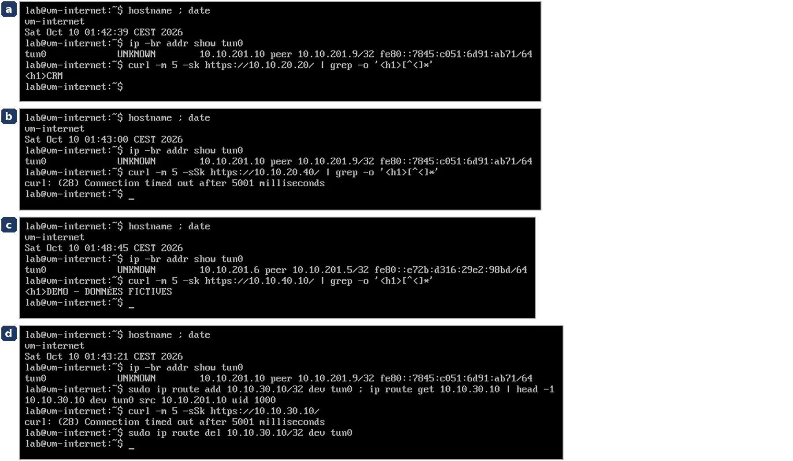

**Figure 39 · Compte commercial : CRM et démonstration autorisés, comptabilité et DMZ-PROD refusées (T11, T12).** (a) T11 (01:42:39) : `u_commercial` (`tun0` 10.10.201.10), `https://10.10.20.20/` renvoie la page CRM. (b) T11 (01:43:00) : `https://10.10.20.40/` (comptabilité), délai dépassé. (c) T11 (01:48:45) : `https://10.10.40.10/` renvoie « DEMO - DONNÉES FICTIVES ». (d) T12 (01:43:21) : route forcée vers 10.10.30.10 par `tun0`, `https://10.10.30.10/` (DMZ-PROD), délai dépassé.

  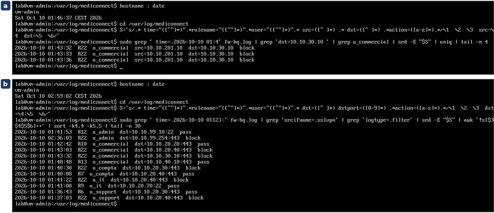

**Figure 40 · Journaux de FW-HQ (T12 et synthèse de l’interface `sslvpn`).** (a) T12 (01:46:37) : trois blocages R22 des flux de `u_commercial` vers 10.10.30.10 (01:43:32, 01:43:33, 01:43:36). (b) Interface `sslvpn` (02:59:02) : R6, R7, R9, R10, R12 et R13 laissent passer les flux autorisés de chaque groupe ; R22 bloque les autres.

  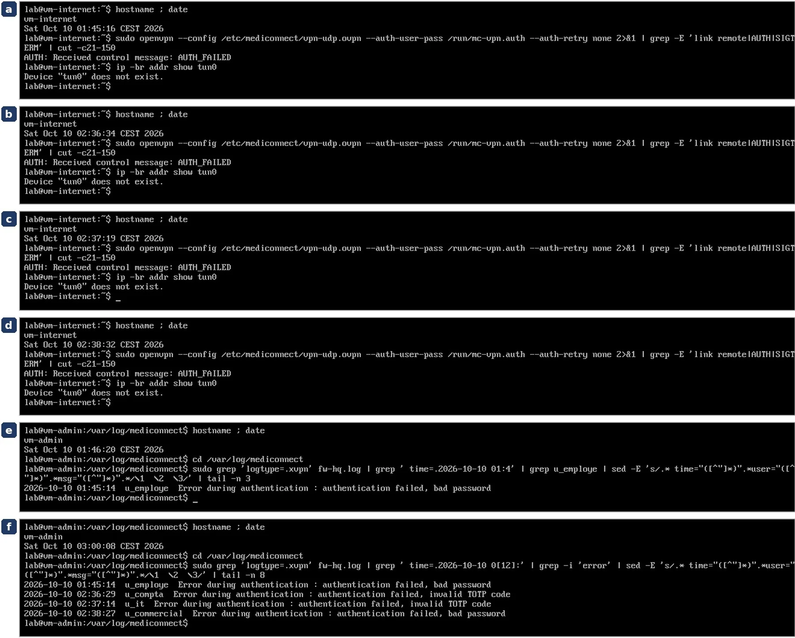

**Figure 41 · Quatre authentifications refusées et leur trace (T14).** (a) T14 (01:45:16) : `u_employe`, mot de passe sans code, `AUTH_FAILED`, pas d’interface `tun0`. (b) T14 (02:36:34) : `u_compta`, bon mot de passe et code faux, `AUTH_FAILED`. (c) T14 (02:37:19) : `u_it`, rejeu d’un code déjà utilisé, `AUTH_FAILED`. (d) T14 (02:38:32) : `u_commercial`, mauvais mot de passe et code valide, `AUTH_FAILED`. (e) T14 (01:46:20) : journal de FW-HQ pour `u_employe`, « authentication failed, bad password » à 01:45:14. (f) Journal de FW-HQ (03:00:08, `logtype=xvpn`) : « bad password » (01:45:14, 02:38:27) et « invalid TOTP code » (02:36:29, 02:37:14).

## 7. Preuves : séparation production et démonstration (T13)

La machine de DMZ-DEMO n’atteint ni SRV-INT, ni Internet, ni le DNS du pare-feu ; le journal montre les blocages R22 correspondants.

  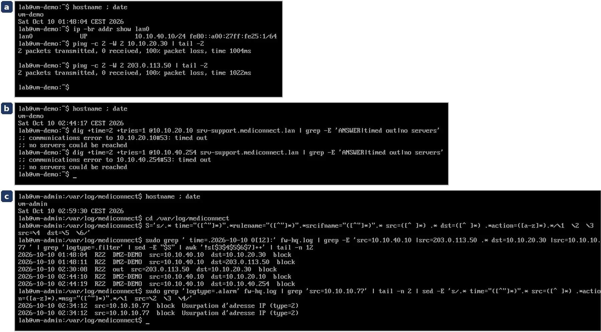

**Figure 42 · DMZ-DEMO isolée (T13).** (a) T13 (01:48:04) : `vm-demo` (10.10.40.10), ping vers 10.10.20.30 et vers 203.0.113.50, 100 % de perte. (b) T13 (02:44:17) : `vm-demo`, `dig` vers 10.10.20.10 et vers 10.10.40.254, aucune réponse (pas de DNS depuis DMZ-DEMO). (c) Journal de FW-HQ (02:59:30) : R22 bloque DMZ-DEMO vers SRV-INT (01:48:04, 02:44:10), vers Internet (01:48:11) et vers le pare-feu (02:44:19), ainsi qu’Internet vers SRV-INT (02:30:08) ; deux alarmes d’usurpation d’adresse du test T25 (02:34:12).

## 8. Preuves : portail captif et matrice d’accès (T15)

Un poste non authentifié n’obtient que le DNS et le portail captif ; après authentification, chaque compte n’atteint que la ressource de son groupe. La matrice est relevée pour quatre comptes (support, comptabilité, employés, informatique) ; les comptes administrateur et commercial sont couverts par T10 à T12.

  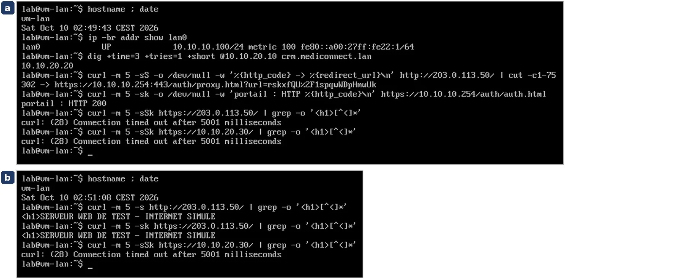

**Figure 43 · Portail captif de LAN-USERS : poste non authentifié puis employé authentifié (T15).** (a) T15 (02:49:43) : `vm-lan` sans authentification, le DNS interne répond (10.10.20.20) ; `http://203.0.113.50/` est redirigé (302) vers le portail `https://10.10.10.254:443/auth/...` ; le portail répond (HTTP 200) ; `https://203.0.113.50/` et `https://10.10.20.30/` en délai dépassé. (b) T15 (02:51:08) : après connexion de `u_employe`, http et https vers 203.0.113.50 renvoient « SERVEUR WEB DE TEST - INTERNET SIMULÉ » ; `https://10.10.20.30/` reste en délai dépassé (pas d’accès au support).

  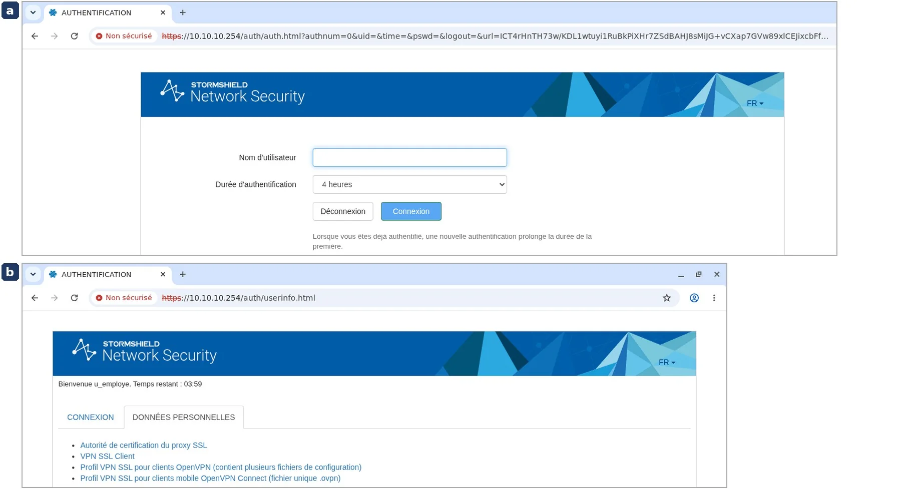

**Figure 44 · Portail captif de FW-HQ (T15).** (a) Page de connexion : nom d’utilisateur et durée d’authentification de 4 heures. (b) Après connexion de `u_employe` : « Bienvenue u_employe. Temps restant : 03:59 ».

  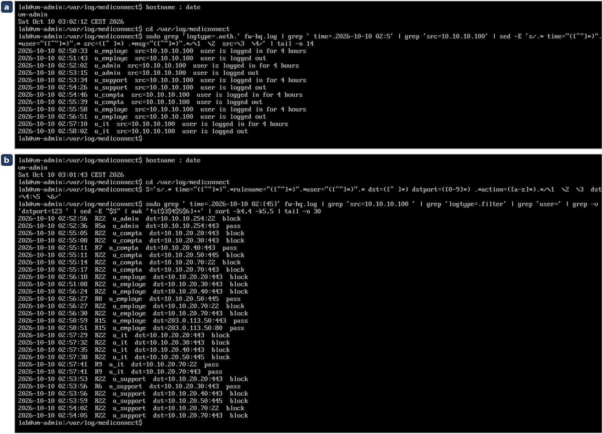

**Figure 45 · Journaux de FW-HQ pour le portail captif et pour les flux des comptes testés.** (a) Authentifications (03:02:12, `logtype=auth`, source 10.10.10.100) : six ouvertures et fermetures de session (`u_employe`, `u_admin`, `u_support`, `u_compta`, `u_employe`, `u_it`). (b) Décisions de filtrage par compte (03:01:43) : R6 (support), R7 (compta), R8 (employés) et R9 (informatique) laissent passer les seuls flux de leur groupe ; R22 bloque les autres ; R15 laisse passer la sortie Internet de `u_employe`.

  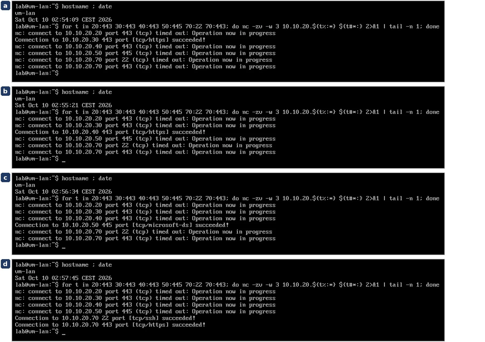

**Figure 46 · Matrice d’accès par compte.** (a) `u_support`. (b) `u_compta`. (c) `u_employe`. (d) `u_it`. Chaque compte n’atteint que la ressource de son groupe.

  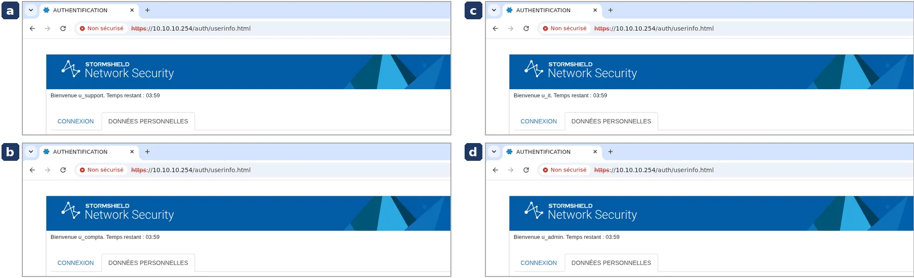

**Figure 47 · Portail captif : sessions ouvertes pour la matrice d’accès et pour le test d’administration.** (a) `u_support`. (b) `u_compta`. (c) `u_it`. (d) `u_admin` (T16).

## 9. Preuves : administration (T16, T17)

Le LAN ne peut atteindre ni l’interface web ni le SSH du pare-feu, même avec un compte administrateur authentifié. Depuis la zone ADMIN, l’interface s’ouvre, le bastion administre les serveurs par clé SSH et le poste d’administration 10.10.99.100 est refusé vers SRV-INT.

  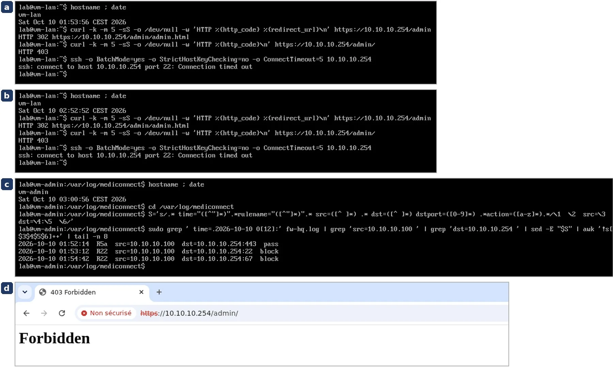

**Figure 48 · Accès refusés depuis LAN-USERS, même avec un compte administrateur authentifié (T16).** (a) T16 (01:53:56) : `vm-lan` sans authentification, `https://10.10.10.254/admin` répond 302 puis `/admin/` répond 403 ; `ssh` vers 10.10.10.254, délai dépassé. (b) T16 (02:52:52) : mêmes résultats avec `u_admin` connecté au portail : l’identité ne suffit pas, l’administration n’est ouverte que depuis la zone ADMIN. (c) Journal de FW-HQ (03:00:56) : R5a laisse passer l’accès au portail (443) ; R22 bloque SSH (22) et BOOTP (67) vers 10.10.10.254. (d) Navigateur : `https://10.10.10.254/admin/` depuis LAN-USERS, « 403 Forbidden ».

  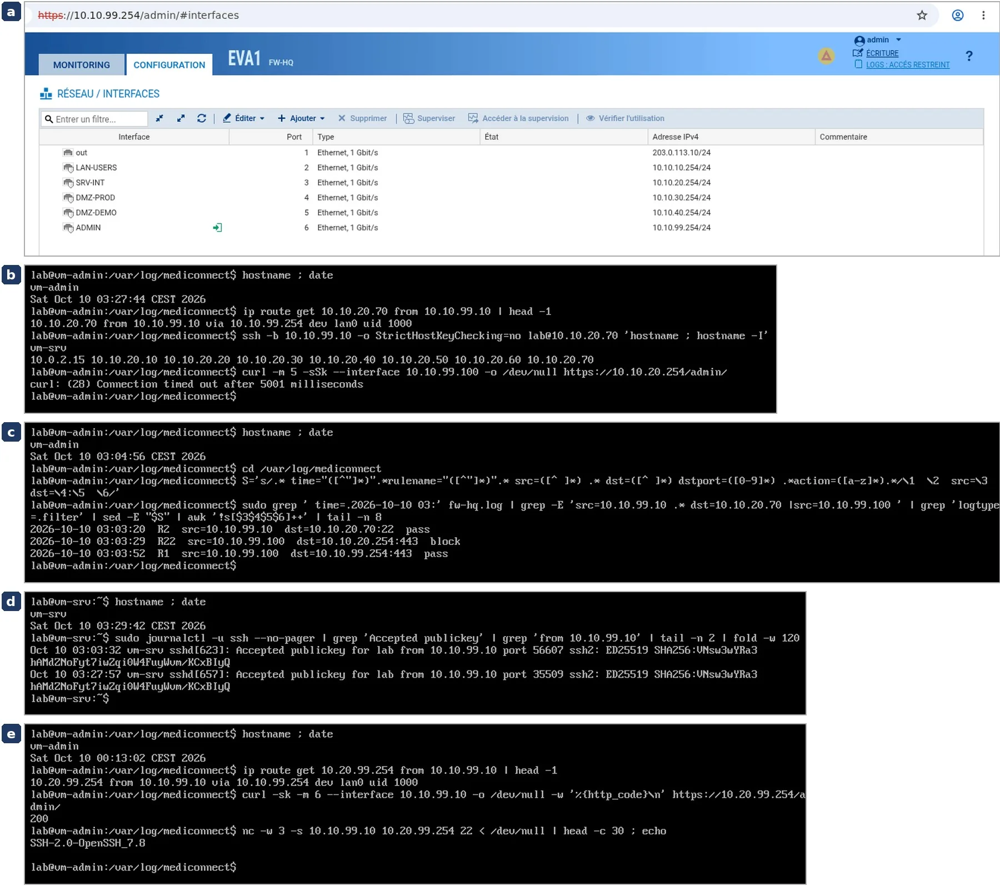

**Figure 49 · Administration depuis la zone ADMIN (T17, T18).** (a) T17 : interface d’administration de FW-HQ ouverte depuis `vm-admin` (zone ADMIN), `https://10.10.99.254/admin/`. (b) T17 (03:27:44) : le bastion (10.10.99.10) ouvre une session SSH vers `vm-srv` (10.10.20.70) ; le poste d’administration 10.10.99.100 n’atteint pas 10.10.20.254 (délai dépassé). (c) Journal de FW-HQ (03:04:56) : R2 laisse passer le bastion vers 10.10.20.70:22 ; R22 bloque 10.10.99.100 vers 10.10.20.254:443 ; R1 laisse passer 10.10.99.100 vers le pare-feu. (d) Journal `sshd` de `vm-srv` (03:29:42) : « Accepted publickey » pour `lab` depuis le bastion 10.10.99.10 (03:03:32 et 03:27:57), authentification par clé. (e) T18 (00:13:02) : administration de FW-BR depuis la zone ADMIN par le tunnel, `https://10.20.99.254/admin/` répond 200, le port 22 répond « SSH-2.0 ».

## 10. Preuves : site 2 et tunnel IPsec (T18 à T21)

Au site 2, le portail de FW-BR authentifie les utilisateurs et les droits par groupe s’appliquent par le tunnel ; LAN-USERS et DMZ-PROD restent inaccessibles et la sortie Internet se fait directement par FW-BR (source 203.0.113.20).

  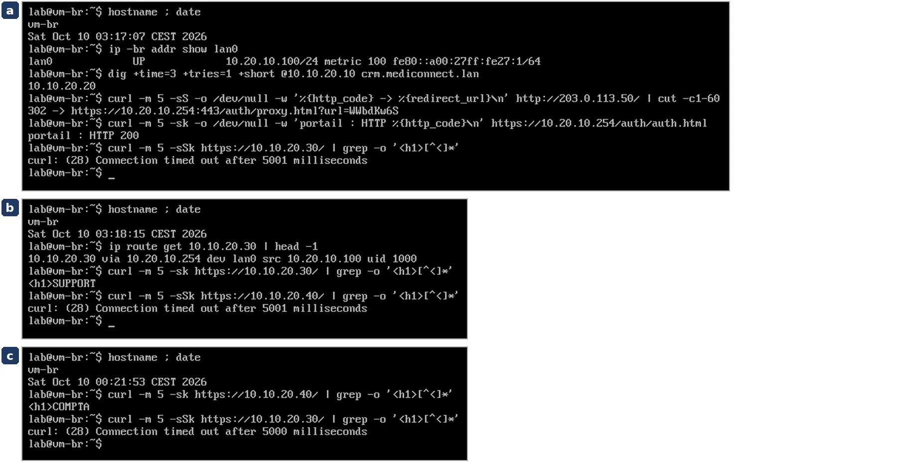

**Figure 50 · Portail captif de FW-BR et accès aux serveurs du siège par le tunnel (T18).** (a) T18 (03:17:07) : `vm-br` sans authentification, le DNS de SRV-INT répond par le tunnel ; `http://203.0.113.50/` est redirigé (302) vers le portail de FW-BR `https://10.20.10.254:443/auth/...` ; le portail répond (HTTP 200) ; `https://10.10.20.30/` en délai dépassé. (b) T18 (03:18:15) : `u_support` connecté au portail de FW-BR, `https://10.10.20.30/` renvoie la page SUPPORT par le tunnel ; `https://10.10.20.40/` en délai dépassé. (c) T18 (00:21:53) : session antérieure (`u_compta`), `https://10.10.20.40/` renvoie la page COMPTA ; `https://10.10.20.30/` en délai dépassé.

  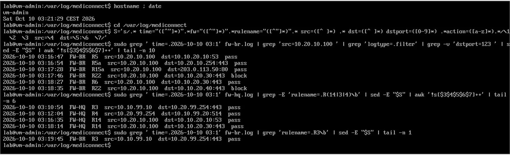

**Figure 51 · Journaux de FW-BR et de FW-HQ pour la même série de tests (T18).** Journaux (03:21:29) : sur FW-BR, R5 (DNS), R5a (portail), R15a (redirection) et R6 (support) laissent passer, R22 bloque ; sur FW-HQ, R14 (tunnel vers SRV-INT), R3 et R4 (administration et syslog) ; sur FW-BR, R3.

  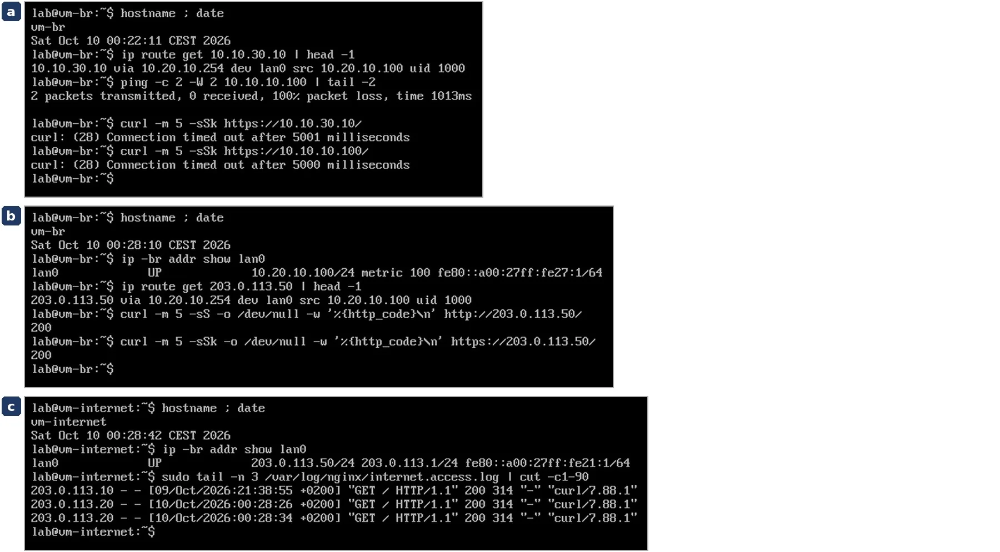

**Figure 52 · Flux interdits vers les zones du siège et sortie Internet propre (T19, T20).** (a) T19 (00:22:11) : `vm-br`, utilisateur authentifié, ping vers 10.10.10.100 avec 100 % de perte ; `https://10.10.30.10/` (DMZ-PROD) et `https://10.10.10.100/` en délai dépassé. (b) T20 (00:28:10) : `vm-br`, http et https vers 203.0.113.50 renvoient 200 (sortie Internet locale du site 2). (c) T20 (00:28:42) : journal nginx de `vm-internet`, requêtes venant de 203.0.113.20, adresse publique de FW-BR (la sortie ne passe pas par le tunnel).

  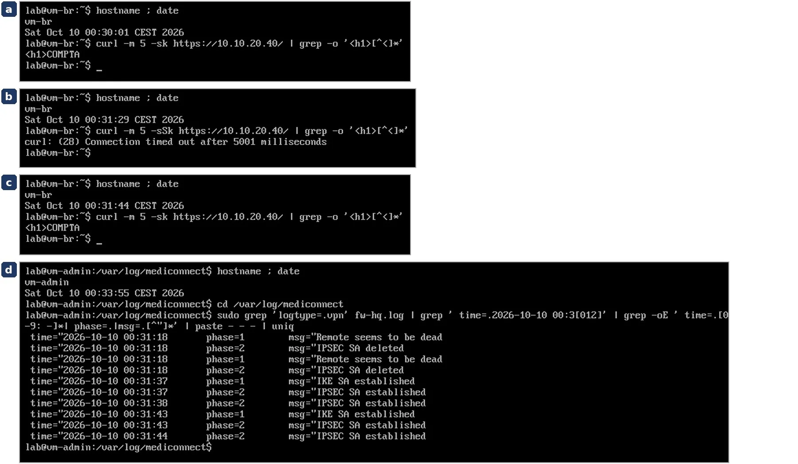

**Figure 53 · Tunnel IPsec : coupure et rétablissement (T21).** (a) T21 (00:30:01) : `vm-br`, avant la coupure, `https://10.10.20.40/` renvoie la page COMPTA. (b) T21 (00:31:29) : liaison coupée, délai dépassé. (c) T21 (00:31:44) : liaison rétablie, la page COMPTA revient. (d) Journal VPN de FW-HQ (00:33:55) : « Remote seems to be dead » et suppression des SA IPsec à 00:31:18 ; SA IKE et IPsec rétablies à 00:31:37 puis 00:31:43.

  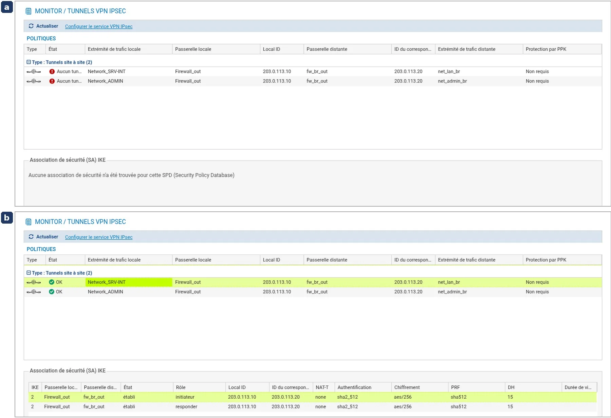

**Figure 54 · Supervision IPsec de FW-HQ pendant la coupure puis après rétablissement (T21).** (a) Pendant la coupure : les deux politiques à l’état « Aucun tunnel », aucune association de sécurité. (b) Après rétablissement : politiques à l’état OK, SA IKE établies.

## 11. Preuves : DMZ, WAF et anti-usurpation (T22, T23, T25)

Depuis DMZ-PROD, seule la base de données est joignable. T23 est complété par T23c, rejoué après l’installation du WAF sur `vm-dmz`. T25 montre le rejet d’une adresse interne présentée depuis Internet ; la figure 57b montre aussi les alarmes SSLv3 et de chiffrement moyen déclenchées par le balayage S05 quelques instants plus tôt.

  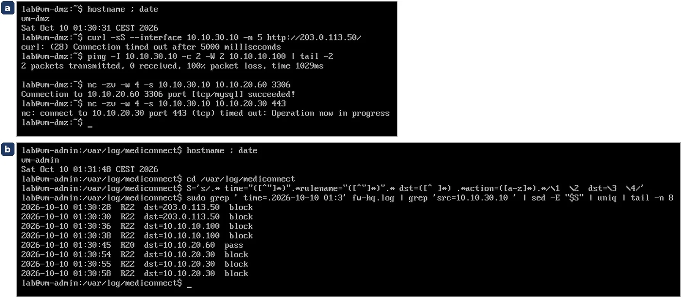

**Figure 55 · DMZ-PROD : le portail ne joint que la base de données (T22).** (a) T22 (01:30:31) : `vm-dmz`, source 10.10.30.10, sortie vers 203.0.113.50 en délai dépassé ; ping vers 10.10.10.100 avec 100 % de perte ; connexion TCP 3306 vers la base 10.10.20.60 réussie ; 443 vers 10.10.20.30 en délai dépassé. (b) Journal de FW-HQ (01:31:48, source 10.10.30.10) : R22 bloque 203.0.113.50, 10.10.10.100 et 10.10.20.30:443 ; R20 laisse passer 10.10.20.60:3306.

  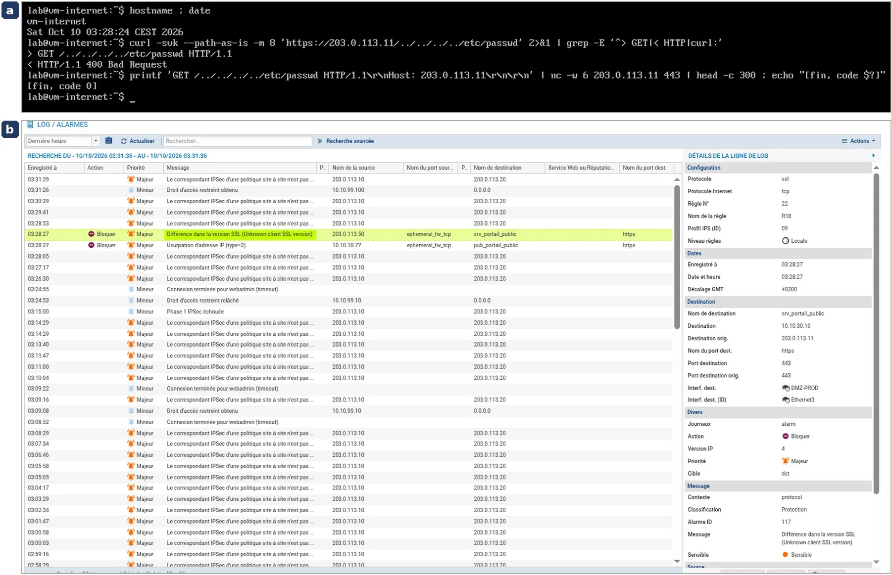

**Figure 56 · Contrôle applicatif : requête de traversée de répertoire vers le portail public (T23).** (a) T23 (03:28:24) : requête `../../../../etc/passwd`, en HTTPS le serveur répond « 400 Bad Request » ; la même requête en clair sur le port 443 ne reçoit aucune réponse. (b) Journal des alarmes de FW-HQ, 03:28:27 : alarme 117 « Différence dans la version SSL (Unknown client SSL version) », action Bloquer, règle R18 (n° 22), profil IPS_09, destination `srv_portail_public`.

  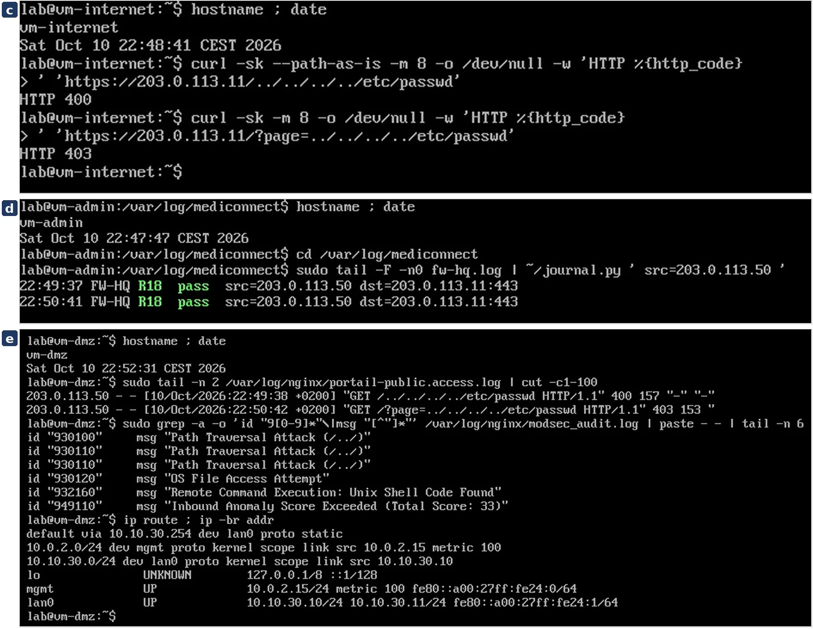

**Figure 56 (suite) · Après l’installation du WAF sur `vm-dmz` (T23c).** (c) T23c (22:48:41) : `vm-internet`, requêtes contre le portail public, `https://203.0.113.11/../../../../etc/passwd` obtient HTTP 400 (nginx, avant le WAF) ; `https://203.0.113.11/?page=../../../../etc/passwd` obtient HTTP 403 (WAF). (d) Journal de FW-HQ lu sur `vm-admin` (22:49:37 et 22:50:41) : R18 pass pour les deux requêtes, sans alarme, le pare-feu ne voit que du TLS. (e) `vm-dmz` (22:52:31) : journal d’accès nginx (400 puis 403), règles CRS déclenchées (930100, 930110, 930120, 932160, 949110 : score d’anomalie 33, accès refusé), puis `ip route` et `ip -br addr` : seule la route par défaut 10.10.30.254, aucune route Internet par la carte `mgmt`.

  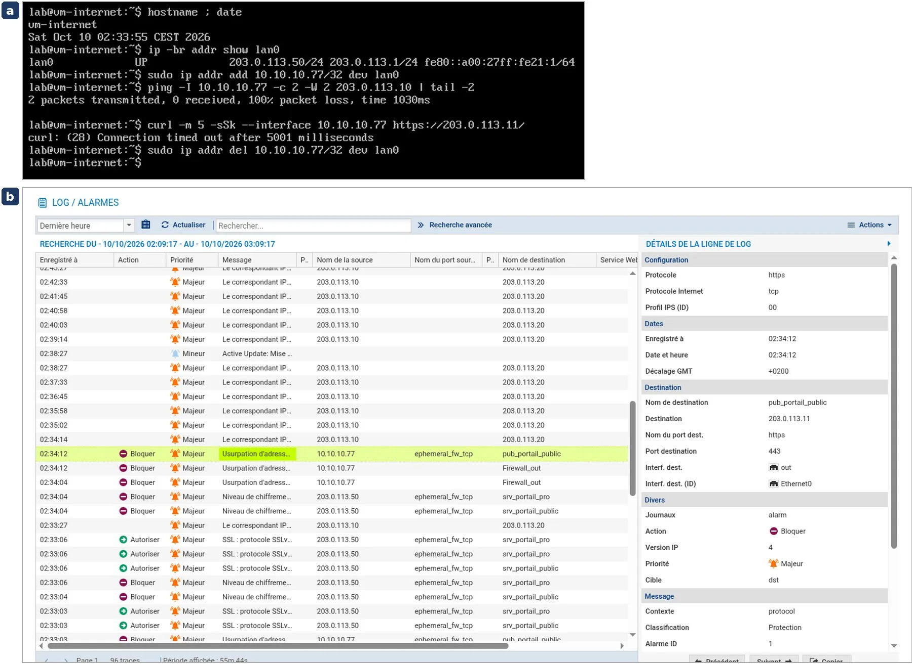

**Figure 57 · Anti-usurpation d’adresse : source interne présentée depuis Internet (T25).** (a) T25 (02:33:55) : `vm-internet`, l’adresse 10.10.10.77 (réseau interne de LAN-USERS) est présentée sur l’interface Internet ; ping et `curl` vers le portail public sans réponse. (b) Journal des alarmes de FW-HQ : « Usurpation d’adresse IP (type=2) », action Bloquer, source 10.10.10.77, à 02:34:04 et 02:34:12.

## 12. Preuves : journalisation (T24)

  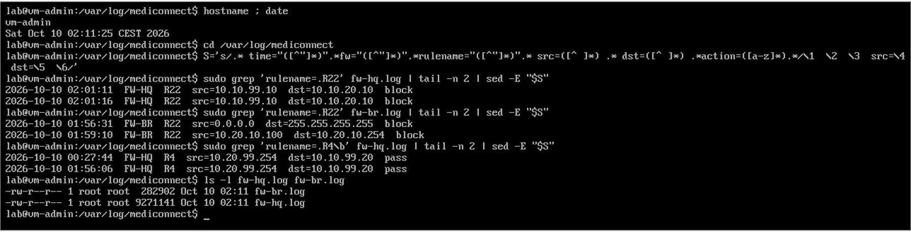

**Figure 58 · Réception des journaux sur le collecteur (T24).** T24 (02:11:25) : R22 de FW-HQ (02:01:11, 02:01:16) et de FW-BR (01:56:31, 01:59:10) ; R4 de FW-HQ, flux syslog de FW-BR par le tunnel (00:27:44, 01:56:06) ; fichiers `fw-hq.log` (9,3 Mo) et `fw-br.log` (283 Ko).

---

**Auteur** : Sami de Waal · Référence MC-SEC-ARC-001 · Campagne de validation d’octobre 2026.
