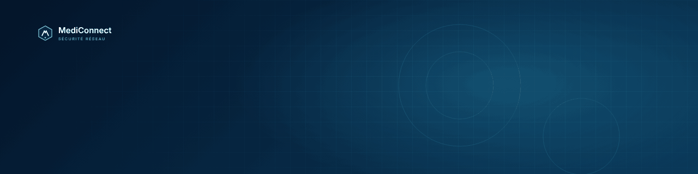
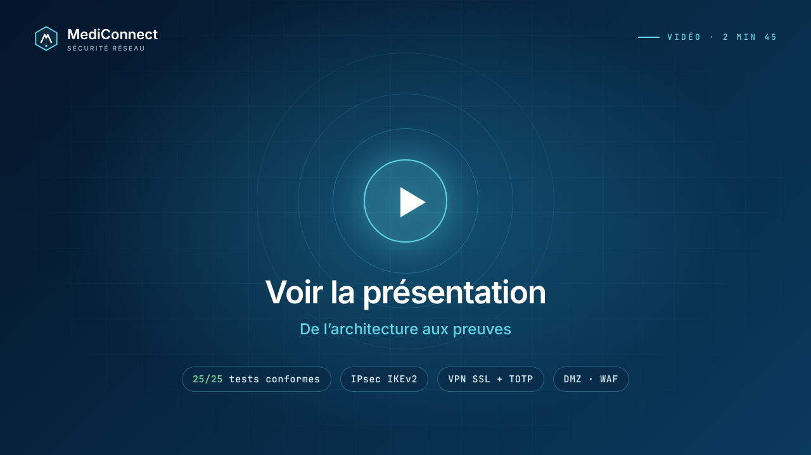
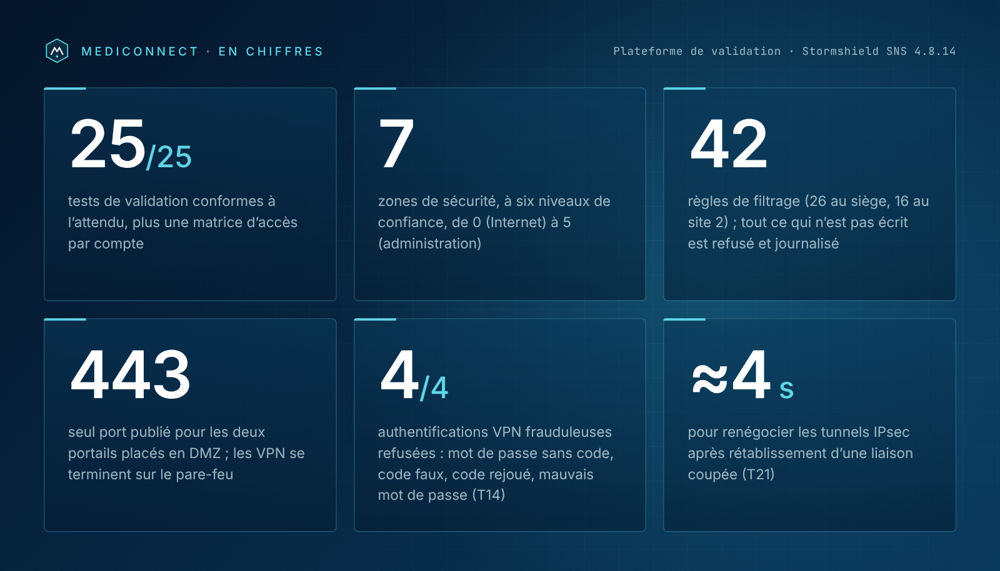
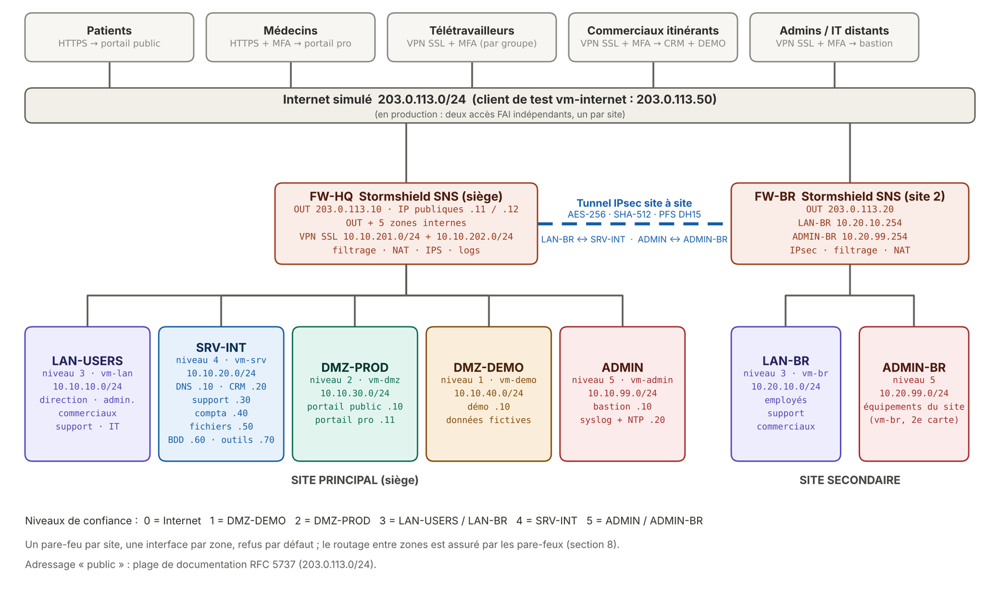
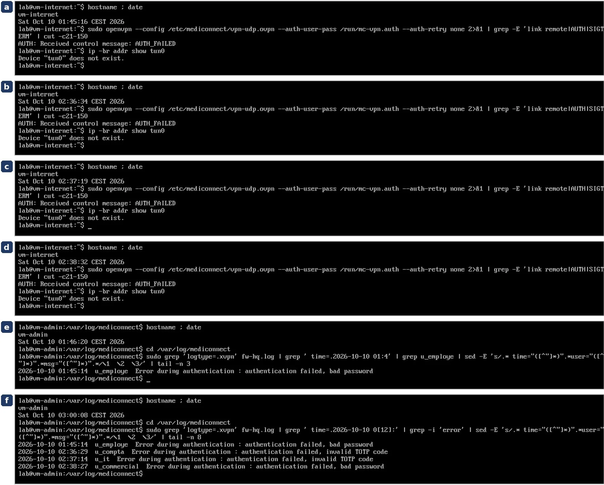
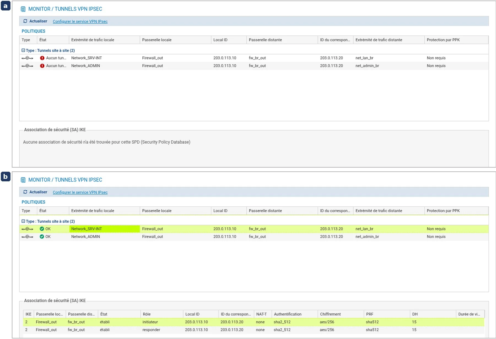
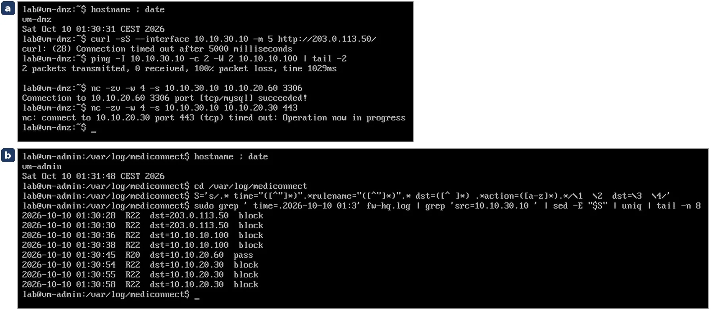
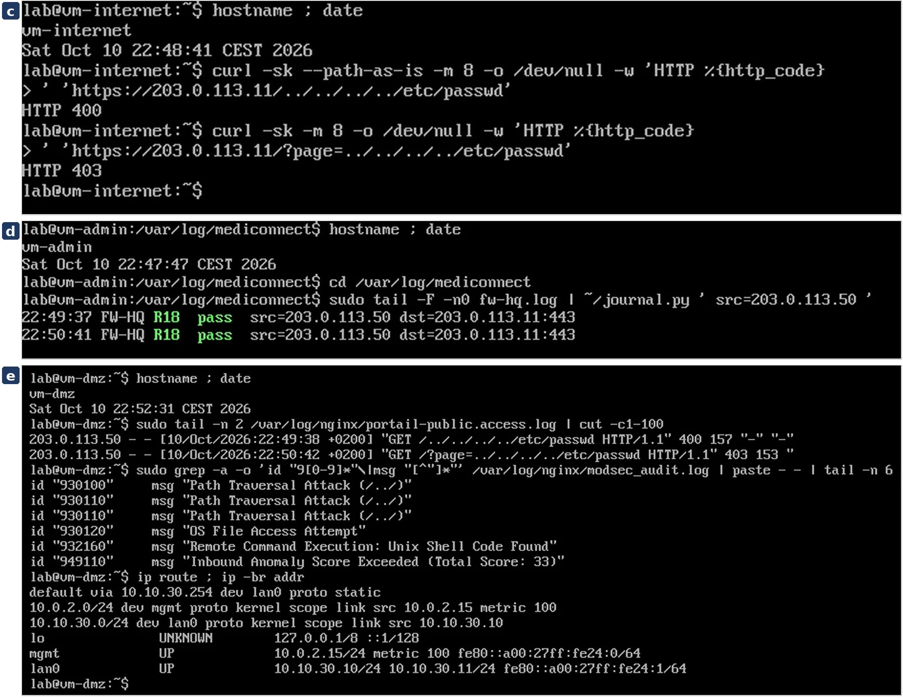
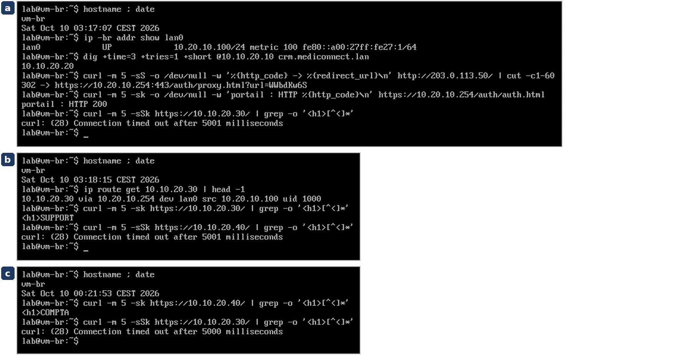
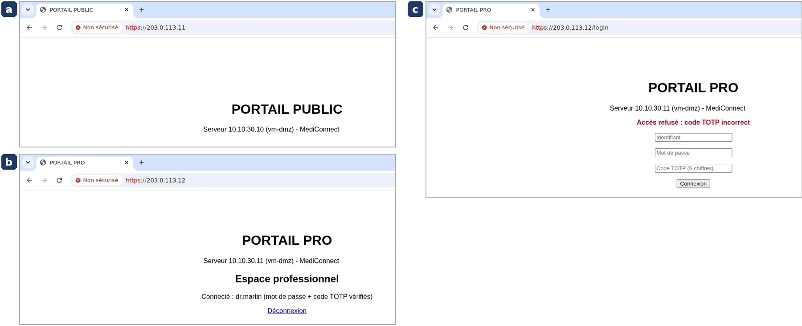

<div align="center">

<picture>
  <source media="(prefers-reduced-motion: reduce)" srcset="assets/banner.png">
  
</picture>

<br>

# MediConnect · Architecture de sécurité réseau

### Segmenté. Authentifié. Testé.

Deux sites, sept zones à confiance graduée, un tunnel IPsec, un VPN SSL à double facteur et un WAF devant les portails : l’architecture de sécurité réseau d’un portail de rendez-vous médicaux, **conçue, mise en œuvre et validée par 25 tests**.

<br>

[**▶ Vidéo**](#présentation-vidéo) &nbsp;·&nbsp; [**Dossier technique**](DOSSIER-TECHNIQUE.md)

<br>

<p align="center">
  
  
  
  <br>
  
  
  
  
  <br>
  
</p>

</div>

<br>

## Présentation vidéo

<p align="center">
  <a href="https://drive.google.com/file/d/1pHIapkmnnF0EHHlVuzEZa0za04IT4aT_/view?usp=sharing"></a>
  <br>
  <a href="https://drive.google.com/file/d/1pHIapkmnnF0EHHlVuzEZa0za04IT4aT_/view?usp=sharing"><b>▶ Regarder la présentation (2 min 45)</b></a>
</p>

De l’architecture aux preuves : segmentation, IPsec, VPN à double facteur, DMZ, WAF et 25 tests. La vidéo est commentée en français.


## En bref

MediConnect exploite un portail de rendez-vous médicaux ouvert aux patients et aux médecins, adossé à un système d’information réparti sur deux sites. Ce dépôt documente l’architecture de sécurité réseau qui protège cet ensemble (segmentation, accès distants, protection des portails, administration et traçabilité) et en apporte la preuve par vingt-cinq scénarios de test rejoués sur une plateforme virtualisée.

<p align="center">
  
</p>

## Le dispositif en six points

1. **Un pare-feu par site.** Deux pare-feux Stormshield SNS 4.8.14 assurent le routage, le filtrage, la traduction d’adresses, les VPN et l’authentification ; tout flux entre deux zones traverse la politique de filtrage.
2. **Sept zones à confiance graduée.** Une montée de niveau n’existe que si elle est nommée dans la matrice de flux ; la règle finale bloque et journalise le reste.
3. **Sites interconnectés.** Un tunnel IPsec IKEv2 permanent (AES-256, SHA2-512, groupe Diffie-Hellman 15, PFS) relie le siège et le site 2 ; seuls deux couples de réseaux y circulent.
4. **Accès distants par l’identité.** Le VPN SSL exige un compte LDAP et un code TOTP ; les droits dépendent du groupe, non de l’adresse IP.
5. **Exposition publique minimale.** Patients et médecins n’atteignent que deux portails en DMZ (TCP 443, TLS 1.2 et 1.3), contrôlés par l’IPS et par un WAF ; la DMZ n’a qu’une ouverture vers l’intérieur, la base de données.
6. **Administration et traçabilité.** Zone ADMIN dédiée, bastion SSH par clé, journaux envoyés en continu à un collecteur syslog central.

## L’architecture

<p align="center">
  
</p>

Chaque zone est raccordée à une interface du pare-feu, qui en est la passerelle ; les niveaux de confiance vont de 0 (Internet) à 5 (administration). Le détail est dans le [dossier technique](DOSSIER-TECHNIQUE.md).

## Qui accède à quoi

| Population | Point d’entrée | Authentification | Périmètre atteignable |
| --- | --- | --- | --- |
| Patients | Portail public, HTTPS, 203.0.113.11 | Compte patient (application) | Portail public seul |
| Médecins | Portail professionnel, HTTPS, 203.0.113.12 | Mot de passe + TOTP (application) | Portail professionnel seul |
| Employés en télétravail | VPN SSL | Compte LDAP + TOTP | Ressources de leur groupe |
| Commerciaux itinérants | VPN SSL | Compte LDAP + TOTP | CRM et démonstration seulement |
| Administrateurs distants | VPN SSL, puis bastion SSH | LDAP + TOTP, puis clé SSH | Bastion d’administration seul |

## Décisions structurantes

| Décision | Justification | Preuves |
| --- | --- | --- |
| **Refus par défaut** | Une règle finale (R22) bloque et journalise tout flux non prévu ; la matrice des flux est exhaustive. | T02, T06, T12, T13, T22 |
| **Portails en DMZ, sans VPN pour patients et médecins** | Ils n’atteignent jamais le réseau interne : deux adresses publiques distinctes, une par portail. | T01, T04, T06 |
| **HTTPS des portails non déchiffré par le pare-feu** | Les données de santé restent chiffrées jusqu’au serveur de la DMZ ; le contenu est contrôlé par un WAF placé devant les portails. | T23, T23c |
| **Droits par groupe, pas par adresse IP** | Un employé obtient les mêmes droits au bureau, en télétravail ou chez un client. | T07 à T12, matrice |
| **IPsec entre sites, VPN SSL pour les nomades** | L’IPsec convient à une liaison permanente entre deux pare-feux ; le VPN SSL traverse la plupart des réseaux et s’authentifie par compte. | T07 à T14, T18 à T21 |

## Les preuves : 25 tests sur 25 conformes

Chaque scénario est rejoué sur la plateforme de validation, depuis la console des machines virtuelles, et documenté par une capture d’écran réelle. Aucun secret n’y figure. Les 25 captures sont réunies dans le [dossier technique](DOSSIER-TECHNIQUE.md).

| Domaine | Tests | Ce qui est démontré |
| --- | --- | --- |
| Portails et exposition à Internet | T01 à T06 | Seul le port 443 est ouvert ; le HTTP reste sans réponse ; aucun accès d’Internet vers le réseau interne, même avec une route forcée ; le code TOTP des médecins est vérifié |
| VPN SSL et droits par groupe | T07 à T12 | Chaque compte n’atteint que les ressources de son groupe ; un commercial ne joint ni la comptabilité ni la production |
| Isolation de la démonstration, authentification forte | T13, T14 | DMZ-DEMO sans aucun flux sortant ; **4 authentifications frauduleuses refusées sur 4** |
| Réseaux locaux et administration | T15 à T17 | Portail captif ; l’interface du pare-feu est inaccessible depuis le LAN, même avec un compte administrateur |
| Site 2 et interconnexion IPsec | T18 à T21 | Droits par groupe au site 2 ; **panne détectée en 67 s, tunnels renégociés environ 4 s après le rétablissement** |
| DMZ, WAF, journalisation, anti-usurpation | T22 à T25 | Le portail ne joint que la base de données ; traversée de répertoire arrêtée par nginx (400) et par le WAF (403) ; journaux centralisés ; usurpation d’adresse rejetée |
| Matrice d’accès | Mat. | Chaque compte n’atteint que la ressource de son groupe |

Six scènes à ouvrir en priorité :

<table>
  <tr>
    <td width="50%" valign="top">
      <a href="assets/captures/fig41-t14-authentifications-refusees.webp"></a><br>
      <sub><b>T14</b> · mot de passe sans code, code faux, code rejoué, mauvais mot de passe : quatre refus</sub>
    </td>
    <td width="50%" valign="top">
      <a href="assets/captures/fig54-t21-supervision-ipsec.webp"></a><br>
      <sub><b>T21</b> · supervision IPsec pendant la coupure, puis après le rétablissement de la liaison</sub>
    </td>
  </tr>
  <tr>
    <td width="50%" valign="top">
      <a href="assets/captures/fig55-t22-dmz-prod.webp"></a><br>
      <sub><b>T22</b> · depuis la DMZ, seule la base de données répond, sur son seul port</sub>
    </td>
    <td width="50%" valign="top">
      <a href="assets/captures/fig56b-t23c-waf.webp"></a><br>
      <sub><b>T23c</b> · la même attaque : 400 pour le chemin exact (nginx), 403 passée en paramètre (WAF)</sub>
    </td>
  </tr>
  <tr>
    <td width="50%" valign="top">
      <a href="assets/captures/fig50-t18-site2-portail.webp"></a><br>
      <sub><b>T18</b> · au site 2, l’accès aux serveurs du siège dépend du groupe, à travers le tunnel</sub>
    </td>
    <td width="50%" valign="top">
      <a href="assets/captures/fig34-t01-t04-t05-portails.webp"></a><br>
      <sub><b>T01 · T04 · T05</b> · les deux portails en HTTPS, puis le code TOTP incorrect refusé</sub>
    </td>
  </tr>
</table>

Les vingt-cinq tests, avec toutes leurs captures, sont dans le [**dossier technique**](DOSSIER-TECHNIQUE.md).


## Compétences démontrées

- **Architecture et segmentation** : sept zones, six niveaux de confiance, deux sites, plan d’adressage sans recouvrement.
- **Pare-feux Stormshield SNS** : politique de 26 règles au siège et de 16 au site 2, matrice de flux exhaustive, NAT, règles implicites désactivées pour l’administration.
- **VPN** : IPsec IKEv2 site à site (AES-256, SHA2-512, PFS, ESN) et VPN SSL OpenVPN à double facteur LDAP + TOTP.
- **Identité** : droits par groupe LDAP, portails captifs, cohérence entre le siège et le site 2.
- **Sécurité applicative** : IPS, contrôle de protocole, TLS 1.2 et 1.3, WAF nginx, ModSecurity v3 et OWASP CRS 3.3.4.
- **DMZ et administration** : une seule ouverture vers l’intérieur, bastion SSH par clé, zone ADMIN dédiée, anti-usurpation d’adresse.
- **Journalisation** : syslog central au format RFC 5424, familles de journaux, synchronisation NTP.
- **Validation et documentation** : vingt-cinq scénarios rejoués avec preuves et dossier technique illustré.


## Plateforme de validation

| Élément | Détail |
| --- | --- |
| Pare-feux | Deux appliances virtuelles Stormshield EVA, SNS 4.8.14 : FW-HQ (siège) et FW-BR (site 2) |
| Machines | Sept machines Debian 12 sous VirtualBox : poste utilisateur, serveurs internes, DMZ de production, DMZ de démonstration, bastion et collecteur syslog, client Internet de test, poste du site 2 |
| Internet simulé | Plage de documentation 203.0.113.0/24 (RFC 5737) |
| Identités | Annuaire LDAP interne du pare-feu (domaine `mediconnect.lan`), sept comptes de test, un par groupe |
| Preuves | Captures réelles des consoles et des pages web, simplement recadrées ; secrets jamais affichés |
| Périmètre | Réseau, accès, VPN, pare-feu, WAF et journalisation, sur deux sites |

## Organisation du dépôt

```text
mediconnect-network-security/
├── README.md              Cette page
├── DOSSIER-TECHNIQUE.md   Plateforme, politique de filtrage, 25 tests et preuves
└── assets/                Images et captures des 25 tests
```

## À propos

- **Projet** : architecture de sécurité réseau pour un portail de rendez-vous médicaux, sur deux sites.
- **Référence** : MC-SEC-ARC-001, version 1.0, novembre 2026.
- **Contexte** : projet individuel, octobre 2026.
- **Campagne de validation** : octobre 2026, vingt-cinq tests plus une matrice d’accès.
- **Éléments de preuve** : les captures des 25 tests et de la matrice d’accès, dans le [dossier technique](DOSSIER-TECHNIQUE.md).
- **Auteur** : Sami de Waal. Projet individuel. Profil : [github.com/dewaalsami359](https://github.com/dewaalsami359).
- **Utilisation** : tous droits réservés. Contenu publié pour être consulté uniquement ; toute copie ou réutilisation nécessite l’accord de l’auteur.
